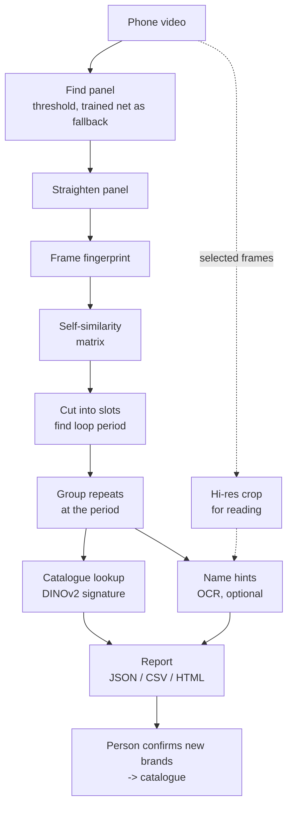
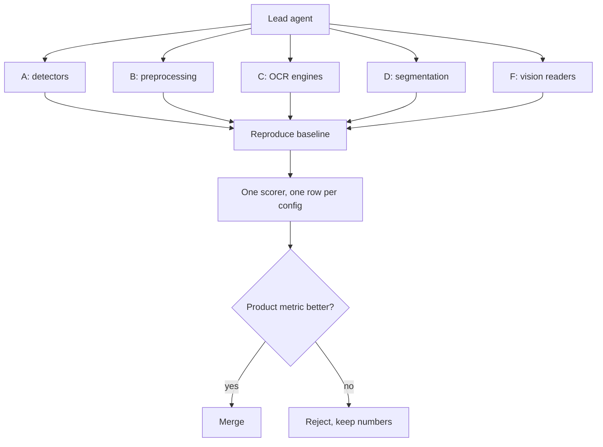

# Reklama Radar

Works out which advertisers ran on a roadside LED screen from a few minutes of phone video.

**since Aug 2026, active · Python · TypeScript · code: private**
## The problem

An outdoor-advertising operator knows what plays on its own LED screens, but not on anyone else's. Its advertisers want exactly that: where competitors are placed, what runs next to them, and how it changes week to week. Today that means sending someone to stand at the screen and write it down.

Brand accuracy matters more than an exact play count: "shown 4 times instead of 5" is acceptable, but naming a brand that was not on screen is a failure. The original ad videos are not available to match against, so recognition relies on what is visible on the screen, plus a one-time human confirmation.

## What it does

- A field worker records an assigned screen at night in a Telegram Mini App for one to two playlist loops. A recording counts only if it was made in the app, near the screen and recently.
- The server finds the panel, straightens it, cuts the video into ad slots and groups repeats. Reading on-screen text (OCR) for naming hints is optional and off by default in the field worker.
- Each slot gets an image signature that is looked up in a catalogue of brands people have already confirmed; a match above a deliberately strict threshold fills in the brand.
- Output per recording: the ad slots, when they ran, with a confirmation frame for each.
- An unfamiliar ad is marked "unknown" rather than guessed. A person names it once, and the catalogue recognises it from then on.
- Reports by screen and by brand, with CSV export.

## How it works

In the field, uploads land in an SQLite-backed queue, and a separate worker runs the same pipeline as the command-line tool.

Research ran on a parallel experiment harness:

## Engineering notes

- **Parallel sweep harness.** Seven agents ran at once, each in its own git worktree, data directory and port. Each branch had to reproduce the baseline exactly, through the production code path, before its results counted. Most results were negative and are recorded: no alternative detector, preprocessing step, OCR engine or embedding beat the baseline.
- **Product metric over proxy metric.** One segmentation change raised boundary F1 from 0.72 to 0.81 but made brand names worse against two independent references (correct names 20 → 15 of 76 and 21 → 17 of 73), so it was rejected.
- **Small models where they win.** The frame fingerprint is a blurred 12×7 thumbnail; CLIP, DINOv2 and SigLIP all lost to it on "same picture or not" within a recording. Panel detection is thresholding, with a trained U-Net only as a fallback. The catalogue signature is a small DINOv2 ViT-S/14: 19 ms per slot on CPU, so no GPU is needed. With OCR off, the worker runs at about 0.055× real time (13.8–29.5 s for 3–5.5-minute field recordings); with OCR on, 0.65×.
- **Two crops per panel.** Features use a small blurred crop; reading re-crops from source resolution. That added 30.2 points of OCR hook recall, against 3.8 for plain upscaling.
- **Grouping by loop period.** Segments are compared only near the playlist period, so similar dark transitions from different advertisers don't merge.
- **Robust queue.** Workers claim jobs from an SQLite table with a conditional update. The API never imports the vision stack, and restarting it loses no jobs. Later hardening, each with a test: atomic worker PID acquisition, non-finite geofence input rejected, stale results cleared on retry, an upload removed when its database insert fails, future-dated Telegram sign-in data rejected, CSV exports that neutralise spreadsheet formulas, and no absolute database path in the public health endpoint.
- **One contract.** OCR, local and hosted vision models answer the same task cards and are scored by one scorer. Auditing that scorer found two bugs, both understating the product: a substring rule that merged different brands sharing a generic word, and a slot counted as a made-up name when its shown frames fell just outside the labelled window. Both rules are now pinned by tests, and the old and new numbers are printed side by side.

## How it is verified

- **Locked metrics.** A regression test pins each quality metric 2 points below its measured value; a deliberately broken detection threshold was confirmed to trip it.
- **Blind hold-out.** Three new screens were labelled from raw frames, and the labels committed before the pipeline ran. Dev-set numbers did not carry over: wrong names from the OCR path rose from 71% to 82%, and the playlist period was found on 0 of 3 recordings, so play counts there are unreliable. Cause, measured: two panels were 69–84% blown-out white, which flattens the fingerprint; the third screen's loop (about 215 s) was as long as the recording itself. On the same hold-out a vision model named 33 of 38 advertisers with 19% wrong, against 10 of 38 for the OCR path.
- **Production path at scale.** On an archive of 511 short clips, top-1 campaign match through the production code was 61.5% by day and 87.0% by night, below the targets of 70% and 91.2%. Recorded as not accepted.
- **Acceptance criteria, one command each:**

  | Criterion | Target | Measured |
  |---|---|---|
  | Brands found (recall) | ≥ 85% | 88.9% |
  | Named brands correct (precision) | ≥ 90% | 88.9%, borderline |
  | Processed without human help | ≥ 85% | 10 of 10 |
  | Time per recording | ≤ 5 min | 211 s worst case, OCR on |
  | "Unknown" instead of a guess | holds | covered by tests |
  | Catalogue match precision | ≥ 90% | 100%, but 1 of 4 repeats found |

  Recall and precision use a vision-model naming step on a small set (18 brands, 22 slots); that step is measured, not yet in the field worker. The OCR-only path scores 16.7% / 15.0%, and run-to-run spread is about 5.6 points, so differences under about 10 points are treated as noise.
- **Model comparison on the same cards.** A low-cost hosted vision model reading three frames of the straightened panel scored the same as a frontier model on the same cards (88.9% / 88.9%). Local open vision models (Qwen-VL, 4B–8B, via Ollama) reached 66.7–72.2% recall; run on two different machines, quality matched and speed differed 4.8–8.4×.
- **Journal checked against history.** A test requires every commit the work journal cites to exist, with a matching title.
- **CI:** ruff, pytest, an import check for every evaluation module, and ESLint, type check and build for the Mini App.

## Stack

Python 3.11 · OpenCV · NumPy / SciPy · scikit-learn · PyTorch (fallback U-Net detector, DINOv2 catalogue signature, optional EasyOCR and RapidOCR) · FastAPI · SQLite · React 19 · Vite · TypeScript · Tailwind · Telegram Mini App · Cloudflare tunnel · GitHub Actions. In evaluation only: CLIP, SigLIP, YOLO-World, SAM 2, Tesseract, docTR, local vision models via Ollama, and hosted vision-model APIs.

## Access

The code is private. To request a walkthrough or read access, open an issue in this repository or email eazamat360@gmail.com.
